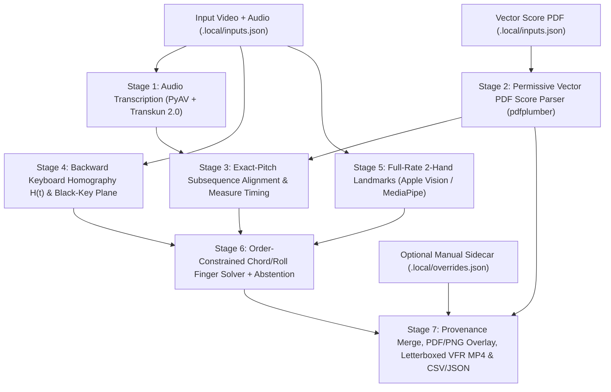

# Proof-of-Concept Design: Local Piano Fingering & Score-Highlighting Pipeline

## 1. Objective & Scope

Produce an offline, local-first proof-of-concept pipeline that takes a performance video (with audio, no performance MIDI) and a digitally typeset vector score PDF (no MusicXML), and generates three musician-evaluatable outputs under `.local/out/`:

1. **Synchronized split-screen teaching video (`.local/out/teaching_video.mp4`)**: hands video on the left (oriented to standard pianist point of view with full-width aspect-preserving letterboxing, orientation/provenance disclosure, and attack-time finger badges) and the original typeset score on the right (tightly framed around the played systems) with current-measure highlighting and observed finger labels.
2. **Annotated score excerpt (`.local/out/annotated_score.pdf` and `.local/out/annotated_excerpt.png`)**: original PDF layout preserved, with collision-aware observed finger labels (`1`–`5`, `(1?)`–`(5?)`, or `?`) overlaid at played score noteheads using native PDF point coordinates; unplayed measures remain blank.
3. **Reviewable prediction table (`.local/out/predictions.csv` and `.local/out/predictions.json`)**: per-note-attack records across the analyzed excerpt preserving simultaneous and rolled chord notes individually, `alignment_status`, ranked candidate fingers, abstention reasons, frame timestamps, calibration residuals, provenance (`auto` vs. `manual_override`), and blank evaluation fields for the pianist.

Operator-written reference labels are **not** a prerequisite. Uncertain cases remain explicitly marked (`unknown` / `?`), and no musician-verified accuracy claim is made prior to her review.

---

## 2. Privacy & Licensing Boundaries

- **Untracked private workspace (`.local/`)**:
  - `.local/inputs.json` resolves local input paths (`video`, `score`). Source files are read in place and never modified.
  - `.local/cache/` (including `.local/cache/bin/` for the compiled Swift Vision helper, plus `XDG_CACHE_HOME`, `MPLCONFIGDIR`, and `TORCH_HOME`) and `.local/models/` store build/runtime caches and local model bundles outside git.
  - `.local/out/` stores all extracted audio, MIDI, landmark traces, score note tables, diagnostic overlays, annotated PDFs/PNGs, prediction tables, and rendered videos.
  - `.local/overrides.json` (optional) stores any manual timing or fingering adjustments as a separate non-destructive layer.
- **Public repository hygiene & two-tier automated privacy guard (`tests/test_privacy.py`)**:
  - `.gitignore` excludes `.local/`, `out/`, `outputs/`, `tmp/`, `.build/`, `*.dSYM/`, media/PDF/image extensions (`*.mp4`, `*.pdf`, `*.png`, `*.jpg`, `*.svg`), tabular/log dumps (`*.csv`, `*.tsv`, `*.jsonl`), and model weights (`*.pt`, `*.safetensors`, `*.task`).
  - Tracked files contain only MIT-licensed code, synthetic unit-test fixtures, architectural documentation, and sanitized aggregate experiment metrics (counts, durations, coverage ratios, failure-mode breakdowns).
  - Tracked files must never contain local filesystem paths, source filenames, score titles, composer/arranger/purchaser identifiers, copyright/watermark notices from private scores, source-derived note sequences, frames, or rendered media.
  - `tests/test_privacy.py` scans all tracked files (`git ls-files`) and staged diffs using two tiers while storing **zero private literals** in tracked code:
    1. **Static universal patterns**: local user home paths, purchaser-authorization watermark prefixes, sheet-music vendor markers, raw camera/catalog filename prefixes, and forbidden media/table file extensions outside synthetic in-memory tests.
    2. **Dynamic local-input scan**: when `.local/inputs.json` exists locally, the test dynamically reads path stems from `.local/inputs.json` and extracts cover/header/footer watermark phrases (title, composer/arranger lines, purchaser watermark name) from the local PDF in memory, asserting none appear in tracked files (explicitly whitelisting the repository author's own copyright line in `LICENSE`).
- **Pipeline upload boundary and review disclosure**:
  - All audio transcription, PDF parsing, hand-pose estimation, alignment, and video rendering run locally offline. The processing pipeline sends no media or derived data to hosted transcription, OMR, or vision APIs.
  - Separate development image inspection placed private rendered diagnostics into assistant multimodal inference contexts. This was not local-model-only review, and explicit approval for hosted image disclosure is not established in the available record. See [review.md](review.md#image-review-disclosure-correction). Local inspection instructions and code-review assignments must not be treated as authorization for further hosted private-image disclosure.
- **Permissive dependency stack (no AGPL conflict in MIT repository)**:
  - No code is copied from repositories with unestablished licenses (e.g., PianoVAM/ASDF is treated strictly as a methodological reference).
  - Selected runtime packages declare permissive licenses; their licenses and bundled notices must be respected: `pdfplumber` / `pdfminer.six` (MIT), `pypdfium2` (Apache-2.0 / BSD-3-Clause), `pypdf` (BSD-3-Clause), `reportlab` (BSD-3-Clause), `transkun` / `moduleconf` (MIT), `opencv-contrib-python` (Apache-2.0), `av` (BSD), `imageio-ffmpeg` (BSD), `scipy` / `numpy` / `pillow` / `torch` (BSD/HPND). AGPL PDF libraries (`pymupdf`) are intentionally excluded. Package licensing does not establish separate rights to bundled pretrained weights; no weights are redistributed here.

---

## 3. Environment & Verified Compatibility

Isolated Python 3.11 environment managed by `uv` (`pyproject.toml`, `.venv/` gitignored), plus macOS native Swift (`swiftc` + `AVFoundation` + `Vision`, compiled on demand to `.local/cache/bin/hand_pose_extractor_<hash>`) for zero-download full-frame hand-pose extraction:

- **Empirically verified Python 3.11 (`arm64` macOS) compatibility constraints**:
  1. `transkun==2.0.1` bundles pretrained weights (`pretrained/2.0.pt`, `2.0.conf`), but its CLI imports `pkg_resources` (removed in modern `setuptools`) and `pydub` (requires system `ffmpeg` on `PATH` and assumes 16-bit PCM). **Mitigation**: load `2.0.pt` and `2.0.conf` programmatically via `importlib.resources.files("transkun")` with `torch.load(..., weights_only=False)`, and decode/resample audio directly via `PyAV` (`av.AudioResampler(format="flt", layout="stereo", rate=model.fs)`) into interleaved float32 `(N, C)` tensors so planar `fltp` channel layouts are never transposed or mis-resampled.
  2. System `ffmpeg` is not installed globally. **Mitigation**: decode and encode video frames with exact source `time_base` and variable-frame-rate `frame.pts` via `PyAV` (`av`), and mux the encoded H.264 stream with the original untouched audio stream (`-c:v copy -c:a copy`) via `imageio_ffmpeg.get_ffmpeg_exe()`.
  3. Depend explicitly on a single OpenCV wheel (`opencv-contrib-python`, without adding `opencv-python` or `opencv-python-headless`) so `cv2` binaries never collide.

---

## 4. Pipeline Architecture & Stage Specifications

The codebase lives under `src/piano_fingering/` with independently runnable, testable stages orchestrated by `uv run piano-fingering run`:

### Stage 1: Audio Note-Attack Transcription (`transcribe.py`)
- Decode audio stream with `PyAV`, recording both the video stream initial timestamp `t_video_0 = float(v_first_pts * v_time_base)` and audio stream initial timestamp `t_audio_0 = float(a_first_pts * a_time_base)`. Convert all transcribed note times onto the video presentation clock via `t_video_clock = t_transkun + (t_audio_0 - t_video_0)` (with `pts_seconds` expressed relative to `t_video_0` consistently across audio and video).
- Resample decoded audio cleanly to `model.fs` (`44100 Hz`) using `av.AudioResampler(format="flt", layout="stereo", rate=model.fs)` producing `(N, 2)` float32 in `[-1.0, 1.0]`.
- Run local Transkun 2.0 inference on CPU for deterministic outputs: `perf_event_id`, `onset_sec`, `offset_sec`, `midi_pitch`, `velocity`.
- **Target boundary**: `onset_sec` estimates physical key attack; `offset_sec` may include sustain pedal and is **never** treated as physical finger-release ground truth.

### Stage 2: Permissive Vector PDF Score & Coordinate Extraction (`score_pdf.py`)
- Extract native PDF vector primitives (`chars`, `lines`, `rects`, `curves`) in top-left PDF point coordinates (`612 × 792 pt`, matching `pypdfium2` raster scaling `px = pt * dpi / 72.0`) via **`pdfplumber` / `pdfminer.six`**:
  1. **Staves & Systems**: Detect horizontal 5-line staff groups (`staff_space` $\Delta y$), pair upper (treble) and lower (bass) staves into grand-staff systems, and extract printed system-start measure numbers (`Tinos`/`Times`/`Arimo` text integers near each system's top-left) as ground-truth measure-index anchors.
  2. **Measures, Double Barlines & Meter Changes**: Detect vertical barlines spanning each grand-staff system. Filter out narrow double-barline gaps and trailing courtesy time-signature boxes (`width < min_measure_width`, e.g., `< 25 pt` or boxes containing only meter digits and zero noteheads) so mid-piece meter changes (`3/4` $\to$ `4/4`) never create phantom empty measures. Assert extracted system-start measure numbers match printed score measure numbers.
  3. **Legacy 8-Bit Music-Font & Vector Semantics**: Decode embedded legacy 8-bit music-font glyphs (`Doremi` char codes + staff-relative vertical origin offsets, without assuming Unicode SMuFL codepoints): filled noteheads (quarter/eighth/sixteenth), hollow half-noteheads, whole-noteheads, clefs (`G`, `F`), time-signature digits (`3/4`, `4/4`), key-signature flats, measure accidentals (`#`, `b`, `n`), augmentation dots, wavy arpeggio-roll stacks, flags, rests, plus vector stems, beams, ledger lines, and Bezier tie curves.
  4. **2nd-Interval Chords & Multi-Voice Polyphony**: Group noteheads on the same staff into simultaneous chord attacks (`chord_group_id`) when they share a vertical stem or satisfy $|\Delta x| \le 1.5 \times w_{\text{notehead}}$ (handling major/minor-2nd clusters where adjacent noteheads sit on opposite sides of a stem), while tracking independent rhythmic voices within a staff when distinct stems/rests coexist at the same horizontal span.
  5. **Pitch Calculation**: Calibrate glyph vertical baseline offset against clef anchors and staff lines; compute diatonic step from `(y_top_left - top_line_y) / (staff_space / 2)`, apply key signature and measure-local accidental state (scoped by staff + diatonic step + octave, reset at barlines).
  6. **Strict Tie vs. Slur Filtering**: Mark a notehead `is_tied_continuation = True` **only** when a shallow horizontal Bezier curve's left and right endpoints land directly adjacent to two **consecutively ordered, identical-MIDI-pitch** noteheads in the same staff/voice (no intervening different-pitch noteheads in that voice), preventing phrase slurs from suppressing genuine note attacks.
- **Verification**: Render pages via `pypdfium2` and emit `.local/out/diagnostics/score_overlay_page_<n>.png` plotting every measure number, bounding box, `chord_group_id`, tie flag, and decoded pitch label, plus automated measure-duration and printed-measure-number assertions.

### Stage 3: Exact-Pitch Subsequence Alignment & Measure Timing (`align.py`)
- **Disambiguating Quasi-Repeated Sections (No Chroma Folding, No Full-Piece Stretching)**:
  - Because piano arrangements frequently repeat harmonic progressions across verses and choruses in different meters (`3/4` vs. `4/4`) or octaves, perform a greedy elastic subsequence candidate search using **exact MIDI pitches** across both staves jointly **plus** normalized inter-onset interval (IOI) / beat-spacing consistency—never octave-folded pitch classes (chroma), and never assuming Measure 1 start or full-score completion.
  - Record both the best-scoring measure subsequence `[m_start, m_end]` and the **top-1 vs. top-2 non-overlapping excerpt alignment score margin** in alignment diagnostics; flag low-margin phrase ambiguity explicitly if top-1 and top-2 are not well separated.
- **Note-Level Correspondence & Rolled Chords**:
  - Within `[m_start, m_end]`, align transcribed note attacks (`perf_event_id`) to non-tied score attack notes (`score_note_id`) via exact-MIDI-pitch matching within a local beat-warped window (`±250 ms`, expanded cleanly for wavy-line arpeggiated `chord_group_id` rolls).
  - Emit a unified event table over the analyzed `[m_start, m_end]` / `[t_excerpt_start, t_excerpt_end]` span with explicit `alignment_status`:
    - `matched`: linked `(perf_event_id, score_note_id)` pair;
    - `unmatched_score`: score attack note in the played span with no transcribed onset (receives `auto_finger = "unknown"`, `abstain_reason = "no_transcribed_onset"`);
    - `unmatched_perf`: extra transcribed audio attack with no score note match (retained in JSON/CSV diagnostics with `score_note_id = null`, `abstain_reason = "unmatched_audio_onset"`, not drawn on score).
- **Measure Highlight Timeline**: Compute monotonic `[t_start_sec, t_end_sec]` for each played measure from matched downbeat/in-measure note onsets and local beat interpolation, terminating active measure highlighting cleanly after the final played measure ends / hands leave the keyboard. Support optional manual bar-timing override in `.local/overrides.json` with explicit `timing_provenance`.

### Stage 4: Backward Keyboard Calibration, Dual-Plane Black-Key Geometry & Camera Tracking (`keyboard.py`)
- **Camera Perspective & Orientation**:
  - Handle behind-music-desk camera angles where the pianist sits at the top of the raw frame facing downward: in raw image coordinates, treble (high pitch) is on the left (`small x`), bass (low pitch) is on the right (`large x`), the white-key front apron faces upward (`small y`), and the black keys / red felt strip lie toward the bottom (`large y`, above the glossy black fallboard).
  - Parameterize orientation explicitly (`music_desk_facing_pianist` vs. `overhead_pianist_pov`) and verify consistency between black-key `2–3` grouping direction and dorsal metacarpal hand chirality.
- **Unoccluded Post-Playing Reference Frame (`t ≈ 19.5–20.2 s`) & Chromatic/Rectified Calibration**:
  - Automatically select hand-free, sharp keyboard frame(s) (`handCount == 0` with strong keybed contrast, e.g., `t ≈ 19.5–20.2 s` immediately after hands lift and before the late `t ≥ 20.5 s` camera swing/blur):
    1. **Chromatic Red-Felt Back Line ($v = 0$)**: Detect the red felt strip via chromaticity (`R - max(G, B)`) and RANSAC line fitting so the glossy fallboard mirror reflection below the keybed is never mistaken for the key back edge.
    2. **White-Key Front Apron Line ($v = 1$) & Projective Pre-Rectification**: Detect the white-key front edge line, rectify the keybed quadrilateral into a projective-corrected strip *before* 1D black-key gap analysis so perspective foreshortening near the cheek block never distorts `2–3` black-key spacing.
    3. **Absolute Octave Anchor**: Locate `2`-key (`C#, D#`) and `3`-key (`F#, G#, A#`) groups and white-key seams in rectified space; anchor absolute MIDI pitch (`21..108`) from the physical `A0, A#0, B0` single-black-key end group at the visible bass cheek block, and cross-verify against aligned audio pitches during steady frames.
- **Intrinsics-Free Coplanar Black-Key Top-Face Mapping**:
  - White-key surfaces lie on plane $Z = 0$ ($H_{\text{white}}: \text{Image} \to (u, v)$ where $u \in [0, 52]$ white-key widths from `A0` to `C8`, $v \in [0, 1]$ from red felt to white-key front), while all black-key top faces lie on a parallel elevated plane $Z = h_{\text{black}} \approx 12\text{ mm}$.
  - Rather than requiring camera intrinsics $K$, fit **both** the white-key plane homography $H_{\text{white}}(\text{ref})$ **and** the empirical black-key top-face homography $H_{\text{black}}(\text{ref})$ directly from the detected visible black-key top-face corners (bases at red felt and visible tips) in the unoccluded reference frame, propagating $H_{\text{black}}(t) = H_{\text{black}}(\text{ref}) \, H_{\text{white}}(\text{ref})^{-1} \, H_{\text{white}}(t)$ (with optional refinement on unmasked visible black-key tips). This fixed reference-plane transfer is an approximation under camera translation, not an exact independent elevated-plane estimate per frame. Under behind-music-desk viewing, a finger pressing near a black key's tip maps onto the detected black-key top-face polygon $(u_{\text{black}}, v_{\text{black}}) \in [0, v_{\text{black\_tip}}]$ via $H_{\text{black}}(t)$ without false `$v > v_{\text{black\_tip}}$` rejection.
- **Backward Per-Frame Homography Tracking $H(t)$ with Per-Frame Edge Re-Snapping**:
  - Decode every frame with exact `pts_seconds` via `PyAV`. Mask out detected hand/arm polygons (dilated convex hulls).
  - Track **backward** from the unoccluded reference frame (`t ≈ 19.8 s` $\to$ `t = 0.0 s`) and forward (`t ≈ 19.8 s` $\to$ end), combining masked keypoint RANSAC homography propagation across the `t ≈ 2.5–4.5 s` camera pan with **per-frame direct re-snapping** to the chromatic red-felt line ($v = 0$), white-key front edge ($v = 1$), and unmasked black-key side edges via Huber/RANSAC optimization (cleanly rejecting localized static outliers such as a pencil resting on an unplayed outer key).
  - **Calibration Gate**: Compute per-frame unmasked black-key edge alignment residual `calibration_residual_kw(t)` (in white-key-width units) and visible inlier span over the played octaves. Mark frames with `calibration_residual_kw > 0.35` or insufficient played-register inliers as `calibration_unreliable = True`.

### Stage 5: Full-Rate Two-Hand Pose Extraction & Coordinate Contract (`hand_pose.py`)
- Compile and invoke a native macOS Swift helper (`.local/cache/bin/hand_pose_extractor_<hash>`) using `AVAssetReader` (decoding raw unrotated `CVPixelBuffer` frames with `.up` orientation matching `PyAV` `frame.to_ndarray()` buffer coordinates, and always asserting identical `(W, H)` dimensions against `PyAV`) + `VNDetectHumanHandPoseRequest` (`maximumHandCount = 2`, revision 1) on **every decoded frame** (~667 frames), recording exact `CMTimeGetSeconds(presentationTimeStamp)`.
- **Explicit Coordinate & Zero-Confidence Contract**:
  - Convert Apple Vision's bottom-left normalized coordinates `(x_vn, y_vn)` to top-left pixel coordinates matching `PyAV`/OpenCV: `x_px = x_vn * W`, `y_px = (1.0 - y_vn) * H`.
  - Immediately filter/mask any joint with `confidence == 0` (Apple Vision's sentinel duplicate fallback coordinate) as missing (`null`) at ingestion so invalid joints never enter geometry or chirality math.
- **Rotation-Invariant Dorsal Metacarpal Chirality (`L` vs. `R`)**:
  - Compute the 2D signed cross product of the rigid dorsal knuckle arch in top-left image coordinates:
    $$c_{\text{palm}} = (\mathbf{p}_{\text{middle\_MCP}} - \mathbf{p}_{\text{wrist}}) \times (\mathbf{p}_{\text{pinky\_MCP}} - \mathbf{p}_{\text{index\_MCP}})$$
    For a palm-down hand viewed from above in top-left pixel coordinates (`+x` right, `+y` downward), $c_{\text{palm}} > 0$ indicates anatomical **Right (`R`)** and $c_{\text{palm}} < 0$ indicates anatomical **Left (`L`)**, invariant to 2D camera rotation (including the 180° music-desk-side orientation and early 20° diagonal tilt) and completely immune to piano thumb-under-finger crossings.
  - Cross-check $c_{\text{palm}}$ against `VNChirality` (resolving occasional duplicate-chirality Vision frames when two well-separated hands have opposite $c_{\text{palm}}$ signs, and flagging `chirality_ambiguous` whenever $c_{\text{palm}}$ magnitude is near-collinear/foreshortened and conflicts with detector chirality).

### Stage 6: Order-Constrained Chord/Roll Finger Assignment at Attack (`assign.py`)
- **Definition**: Predict `(hand, finger)` with `hand ∈ {L, R}` and `finger ∈ {1, 2, 3, 4, 5}` (`1=thumb .. 5=little`) **at physical note attack `onset_sec`**.
- **Per-Note Attack Window & Dual-Plane Projection**:
  - For each matched note attack `(p, t_0)`, gather calibrated fingertip detections in its own individual window $[t_0 - 0.07\text{ s}, t_0 + 0.10\text{ s}]$ (using actual frame `pts_seconds`, requiring tip `confidence >= 0.45`).
  - Project fingertips via $H_{\text{black}}(t)$ when $p$ is a black key and via $H_{\text{white}}(t)$ when $p$ is a white key.
  - **Hard Visual Support Gate**: Aggregate attack-window observations using a Gaussian temporal weight ($\sigma = 0.055\text{ s}$) centered at $t_0$, and reject candidate finger $f \in \{L1..L5, R1..R5\}$ if:
    - Gaussian-weighted lateral distance $|\Delta u_{f,p}| > 0.85$ white-key widths from key $p$'s contact center, or
    - projected $v_{f,p}$ lies outside key $p$'s physical longitudinal span (e.g., on the white-key front apron $v_{\text{black}} > 1.05 \, v_{\text{black\_tip}}$ when $p$ is a black key, or off the keyboard $v \notin [-0.08, 1.08]$).
    **No ergonomic or sequence prior may rescue a gated-out candidate.**
  - **Unary Candidate Cost $C(i, f)$**:
    $$C(i, f) = w_u |\Delta u_{f,p_i}| + w_{\text{slip}} |\dot{u}_f(t_{0,i})| + w_v \,\text{pen}_v(v_{f,p_i}, p_i) + w_{\text{conf}}(1 - \bar{c}_f) + w_{\text{staff}} \mathbb{I}[\text{hand}(f) \neq \text{expected\_hand}(\text{staff}_i)]$$
    prioritizing lateral key alignment $|\Delta u|$ and lateral stability $|\dot{u}|$ at $t_0$ (with zero/negligible $\dot{v}$ key-dip weight so finger curl/extension motion along the key length never biases selection, and minor staff tie-breaker $w_{\text{staff}} = 0.12$ key-width equivalents).
- **Simultaneous + Rolled-Chord Clustering & Exact Order-Constrained DP Solver**:
  - Group matched attacks into a joint cluster when **either** $|\Delta t_0| \le 45\text{ ms}$ **or** notes share the **same score `chord_group_id` with roll spread $\le 250\text{ ms}$** (never merging distinct sequential melody beats merely from pedal-extended `offset_sec` overlap)—while keeping each note's unary cost $C(i, f)$ evaluated at its **own** attack timestamp $t_{0,i}$.
  - Sort cluster notes by ascending MIDI pitch $p_1 < p_2 < \dots < p_k$ and solve an **exact order-constrained dynamic program** over ordered anatomical finger states:
    $$\mathcal{F}_{\text{ordered}} = (L5, L4, L3, L2, L1,\; R1, R2, R3, R4, R5) \quad \text{plus per-note } \texttt{unknown}$$
    with fixed abstention penalty $\lambda_{\text{unk}}$ (calibrated to the `0.85` key-width gate):
    - Every non-abstained note assigned to the **same hand** (`L` or `R`) must use **strictly increasing finger indices** in $\mathcal{F}_{\text{ordered}}$ as pitch increases ($p_a < p_b, \text{hand}_a = \text{hand}_b \implies \text{idx}(f_a) < \text{idx}(f_b)$), guaranteeing both mutual exclusion (no duplicate finger on 2nd-interval or rolled chords) and biomechanical non-crossing within simultaneously held chords.
    - Individual unsupported or occluded chord tones transition cleanly to `unknown` (`1 - 2 - ? - 5`) without corrupting well-observed chord tones.
- **Disjoint Confidence Tiers & Structured Abstention**:
  - Compare optimal cluster assignment cost against best alternative finger $f' \neq f^*$ for each note $i$ ($\Delta C_i = C_{\text{best\_alt}}(i) - C_{\text{opt}}(i)$):
    - `unknown` (`gray ?`): solver selected `unknown`, or $\Delta C_i < 0.12$ key-width equivalents (`abstain_reason = "ambiguous_candidates"`), or upstream `calibration_unreliable` / `no_hand_detected` / `low_landmark_confidence` / `no_finger_within_gate` / `no_transcribed_onset`;
    - `low` (`amber (f?)`): emitted finger with $0.12 \le \Delta C_i < 0.28$ or unary distance $0.45 < |\Delta u| \le 0.85$;
    - `high` (`solid dark blue f`): emitted finger with $\Delta C_i \ge 0.28$ and $|\Delta u| \le 0.45$ and tip confidence $\ge 0.65$.
  - Record full ranked `candidate_fingers` list on every event.

### Stage 7: Overrides, Collision-Aware Annotated Score & Letterboxed VFR Video Export (`render.py`, `cli.py`)
- **Non-Destructive Manual Layer**:
  - Load `.local/overrides.json` if present (default: absent, 0 manual edits). Any overridden measure timing or finger preserves `auto_hand`, `auto_finger`, `auto_confidence_tier` untouched and sets `provenance = "manual_override"`.
- **Permissive Native Annotated Score Outputs (`.local/out/annotated_score.pdf`, `.local/out/annotated_excerpt.png`)**:
  - Build a transparent vector annotation layer in **`reportlab`** (`(x_pt, 792 - y_pt)` bottom-left point transform) and merge onto the original PDF pages via **`pypdf`** (rasterizing `.local/out/annotated_excerpt.png` via **`pypdfium2`**, cropped cleanly around the analyzed systems excluding bottom-margin purchaser watermarks):
    - Subtle measure framing on `[m_start, m_end]`; unplayed measures remain completely blank.
    - **Collision-Aware Chord & Single-Note Label Placement**: Track occupied bounding boxes of existing PDF text/chord symbols, dynamics markings, pedal instructions, staff lines, and noteheads. For multi-note chords, place a compact pitch-ordered vertical finger stack immediately **to the left** of the chord/arpeggio roll (or offset cleanly outside occupied chord-symbol bboxes above/below the staff) with a subtle white knock-out halo so digits never collide with chord names, ledger lines, or noteheads.
    - Legend distinguishing `high` automatic (`solid blue 3`), `low` automatic (`amber (3?)`), `unknown` (`gray ?`), and `manual_override` (`green 3*`, if any).
- **Split-Screen VFR Teaching Video (`.local/out/teaching_video.mp4`)**:
  - `1920 × 1080` canvas encoded via `PyAV` `libx264` copying the **exact source video `time_base` and per-frame `pts`** (verified `max(|out_pts - in_pts|) < 1 ms`), muxed via `imageio-ffmpeg` (`-c:v copy -c:a copy`) with the original audio stream:
    - **Left pane (`960 × 1080`) — Full-Width Aspect-Preserving Letterbox**: Rotate the full `1920 × 1080` (`16:9`) frame 180° into standard **pianist POV** (bass on left, treble on right, hands entering from bottom) and scale without horizontal cropping to `960 × 540` centered vertically (`y ∈ [270, 810]`), guaranteeing hands near the extreme frame edges during early camera pan (`x ∈ [0.73, 0.99]`) remain 100% visible. Draw upright fingertip attack pills (`R1`–`R5`, `L1`–`L5`, `?`) at rotated pixel coordinates `(W - 1 - x_px, H - 1 - y_px)` *after* frame rotation. Use the clean top/bottom `960 × 270` letterbox bands for the `"Pianist POV (180° rotated)"` badge, media timestamp + active measure readout, calibration status indicator, and confidence/provenance legend.
    - **Right pane (`960 × 1080`) — Cropped Active-Systems Score View**: Render the annotated score page via `pypdfium2` at high DPI, cropped tightly to the played systems (maximizing notation legibility and excluding bottom-margin personal watermarks from the video), overlaid with a smooth translucent measure-highlight rectangle tracking `current_measure(pts_seconds)` and active notehead pulse at `onset_sec`.

---

## 5. Measurement Validity & Verification Plan

1. **Unit & Synthetic Tests (`tests/`)**:
   - Synthetic dual-plane keyboard homography, black-key elevation projection, dorsal knuckle-arch chirality (`c_palm`), and order-constrained chord/rolled-chord DP solver tests (verifying mutual exclusion, pitch monotonicity, and partial-chord `1 - 2 - ? - 5` abstention).
   - Synthetic vector-staff pitch/accidental/2nd-interval-chord/courtesy-meter-box/strict-tie decoding tests.
   - Subsequence alignment tests across quasi-repeated `3/4` vs. `4/4` / octave-shifted phrases ensuring short excerpts are never stretched across full scores and top-1 vs. top-2 margin is reported.
   - Two-tier zero-secret privacy guard test (`tests/test_privacy.py`).
2. **Stage-by-Stage Empirical Audit on Local Sample (recorded in sanitized `docs/experiment-log.md`)**:
   - **Audio transcription**: note count, onset span, pitch range, audio-video `pts_0` offset, runtime.
   - **Vector PDF extraction**: pages/systems/measures parsed, printed-measure-number match rate, beat-sum consistency rate, visual inspection of diagnostic score overlays.
   - **Excerpt alignment**: identified measure span `[m_start, m_end]`, top-1 vs. top-2 subsequence alignment margin, `matched` / `unmatched_score` / `unmatched_perf` counts, onset residual distribution.
   - **Keyboard & hand tracking**: calibrated frame ratio, median/95th-percentile unmasked key-edge residual (in key widths), two-hand detection rate and `c_palm` vs. `VNChirality` agreement across all ~667 frames.
   - **Finger assignment**: total excerpt score attacks, matched attacks, emitted `high`-confidence count, emitted `low`-confidence count, `unknown` count broken down by `abstain_reason`, manual intervention count (`0` for pure automatic run; explicitly itemized if `.local/overrides.json` is used).
   - **Direct media & sync inspection**: assert VFR `pts` fidelity (`< 1 ms`), audio/video stream duration match, visually inspect composite video frames across early diagonal pan, steady playing, rolled chords, and post-playing hand departure, and visually inspect `.local/out/annotated_excerpt.png` for label legibility and symbol collisions.
3. **No Premature Accuracy Claims**:
   - Until the pianist evaluates `.local/out/teaching_video.mp4`, `.local/out/annotated_score.pdf`, and `.local/out/predictions.csv`, report **coverage, alignment margins, geometric residuals, and abstention breakdowns**, never "verified fingering accuracy."

## Review corrections and implementation limits

The takeover review accepted this output-first design before corrective code changes. Earlier design-review history was not recoverable and is not asserted here. See [review.md](review.md) for findings and resolution evidence.

- Cache reuse requires a complete manifest binding source SHA-256 hashes, Python source hashes, dependency manifests, device and all Stage 1–5 output hashes. Incompatible or partial caches fail closed. A fresh run invalidates the manifest before any stage is written.
- Privacy checks read index blobs as well as tracked/unignored working files, including files deleted or cleaned after staging.
- Video verification requires matching nonempty frame counts, presentation-time error below 1 ms and A/V initial-offset error at most 5 ms. These checks establish container-clock preservation, not perceptual finger/audio alignment.
- Reference calibration requires an accepted finite black-key fit, a visible bass cheek-block anchor, finite full-rank mappings, and the same residual/inlier/apron gates used on other frames. Other camera orientations and absent octave anchors are outside this PoC's supported route.
- Non-overlapping excerpt alternatives within 3 score units or a 1.10 score ratio trigger an explicit ambiguity flag and unknown finger labels; these thresholds are heuristic. The selected measure highlight remains a candidate alignment for review.
- Timing sidecars preserve original automatic intervals in exported prediction JSON, and reject nonfinite, reversed or overlapping intervals. Tie endpoints must share a voice.
- Label placement reserves text, noteheads and arpeggio strips with heuristic fallback; it does not prove collision-aware layout for arbitrary scores. Synthetic tests cover selected parser geometry/pitch utilities, not the complete notation grammar. Black-key reference fitting assumes nominal key geometry; its fixed correction during camera motion is approximate.
